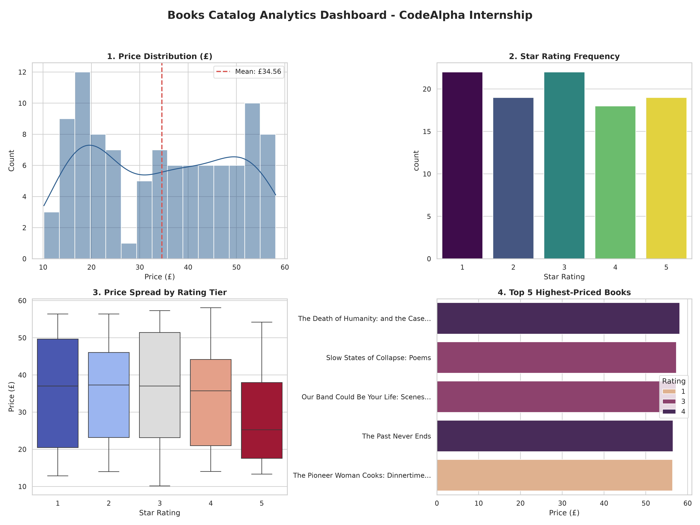

# CodeAlpha_DataVisualization
# CodeAlpha - Data Visualization Task

## 📌 Project Overview
This project is the third and final task of my **CodeAlpha Data Analytics Internship**. It transforms the book catalog dataset collected in Task 1 and analyzed in Task 2 into clear, actionable visual stories using **Python**, **Matplotlib**, and **Seaborn**.

## 📊 Analytics Dashboard

## 🔍 Visual Insights & Storytelling
1. **Price Distribution (`1_price_distribution.png`):** Book prices span broadly from ~£10 to ~£60 with a uniform spread and no extreme pricing outliers.
2. **Star Rating Breakdown (`2_rating_distribution.png`):** Customer ratings are well-distributed across all tiers (1 to 5 stars), showing balanced customer feedback.
3. **Price vs. Rating Relationship (`3_price_vs_rating_boxplot.png`):** The median price and interquartile range (IQR) remain consistent across all rating levels, visually confirming our statistical finding from Task 2 that higher prices do not guarantee higher ratings.
4. **Top Priced Inventory (`4_top_10_expensive_books.png`):** Highlights the premium-priced titles in the catalog alongside their respective customer ratings.

## 🛠️ Tools & Libraries Used
- **Python 3**
- **Pandas:** Data preparation and aggregation.
- **Matplotlib & Seaborn:** Statistical plotting, multi-panel dashboard layout, and high-DPI export.

## 🚀 How to Run
1. Install dependencies: `pip install pandas matplotlib seaborn`
2. Ensure `books_dataset.csv` is in the same directory.
3. Run the script: `python visualize_data.py`
